# BSimVis

<p align="center">
  
</p>

BSimVis is a tool to analyze similarities across a collection of binaries, based on [Ghidra](https://github.com/nationalsecurityagency/ghidra) analyzers and the BSim (Behavioral Similarity) plugin. It provides an API and Web interface to upload large quantities of decompiled binaries and BSim feature vectors to a Kvrocks database for similarity analysis, function diffing, and family clustering.


BSimVis uses a custom database because Ghidra's BSim databases don't store decompiled code and other metadata. This alternative BSim database and API provide filtering and visualization of this additional data across multiple binaries at once. It doesn't aim to replace Ghidra's BSim plugin, but to enable more advanced analysis and visualization of the similarities on a large scale (family clustering, etc.).

Version 1.0 makes BSimVis a family analysis tool: compare every sample of a family at once, follow its lineage over time, and see where each piece of code first appeared. See the [changelog](doc/whats_new.md).


<picture>
  <source media="(prefers-color-scheme: dark)" srcset="img/bsimvis_preview_dark.gif">
  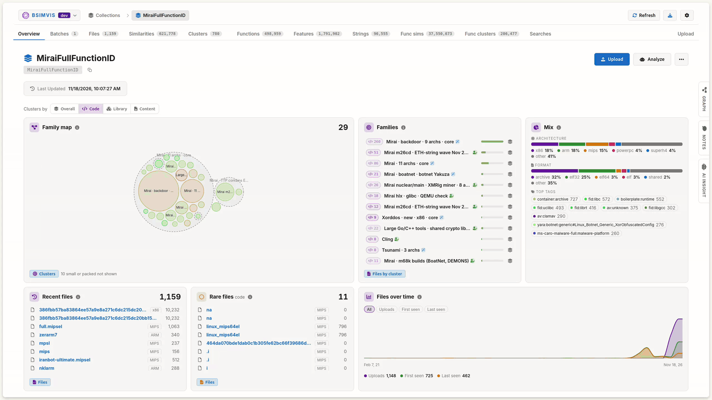
</picture>

# Features

### Analysis
- Upload binaries, archives or Ghidra projects; headless Ghidra decompiles them and extracts BSim vectors, strings and the control-flow graph
- Scan mode: compare a sample with every collection without storing it, then commit it if it is worth keeping
- Function similarity search across binaries (weighted cosine over BSim features by default), with discovery of weaker matches when two files are compared
- Function and file diffing: code blocks, CFG, callers and callees, strings
- Library and boilerplate code split from the original code (FunctionID, boilerplate tags), so file scores and clusters follow the malware code

### N-way diff and lineage
- Compare a whole family at once: functions grouped into lanes (the code a set of files shares) under Core / Common / Rare tiers
- Lineage page: the family as a tree, a timeline by first-seen date, the births of new code, and a ring of sub-clusters

### Clustering
- Hierarchical file and function clustering (single linkage with a cohesion cut, shared-nearest-neighbour reweighting for files), with family overviews and dendrograms
- Cluster names, notes and bookmarks that survive rebuilds; cluster timelines and activity ranking

### Cross-Collection Pools
- Combine multiple collections into a pool for similarity search and clustering across their union
- Search endpoints accept a `pool` parameter; per-pool build/cluster jobs with sync-status tracking

### Search & Filtering
- Full text search on files, functions and strings with sorting, filtering, and pagination
- Collection overview: families, uploads over time, architecture and tag mix

### Tagging
- YARA, capa and Rulezet tags with the rule behind each tag; a YARA workbench (experimental) to write and test rules against stored samples
- Metadata inferred from neighbour files

### Web Interface
- Similarity graph, call graph and CFG views
- Dynamic window management for multiple code previews
- Tag management for files, functions, and similarities
- Table selection and copy across all views

### Analyst Notes & AI Insights
- Analyst notes and function names for files, functions and clusters
- LLM assistant for file and function summaries and lane names (local or remote via Ollama)

### API
- REST API with Swagger documentation, plus an MCP server for AI agents
- Upload API: processor/compiler config, profiling, batch metadata, and similarity params

# Screenshots

## Collection overview

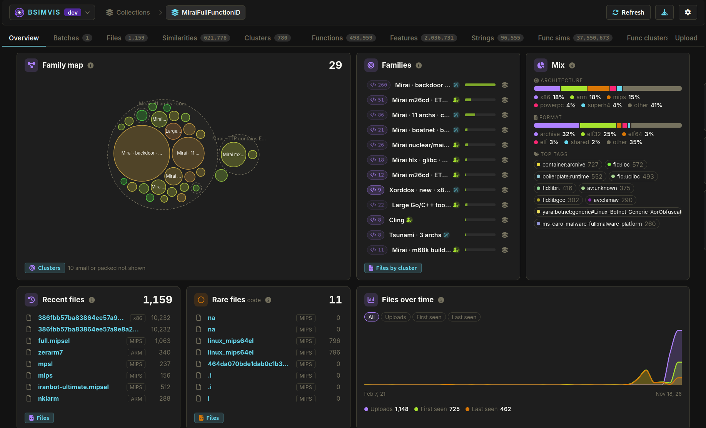

## N-way diff

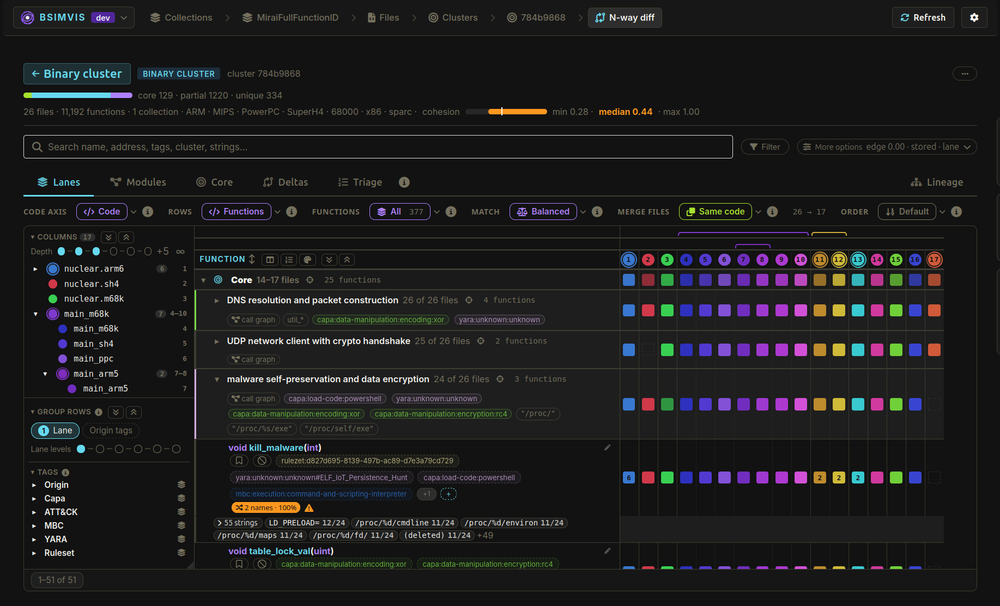

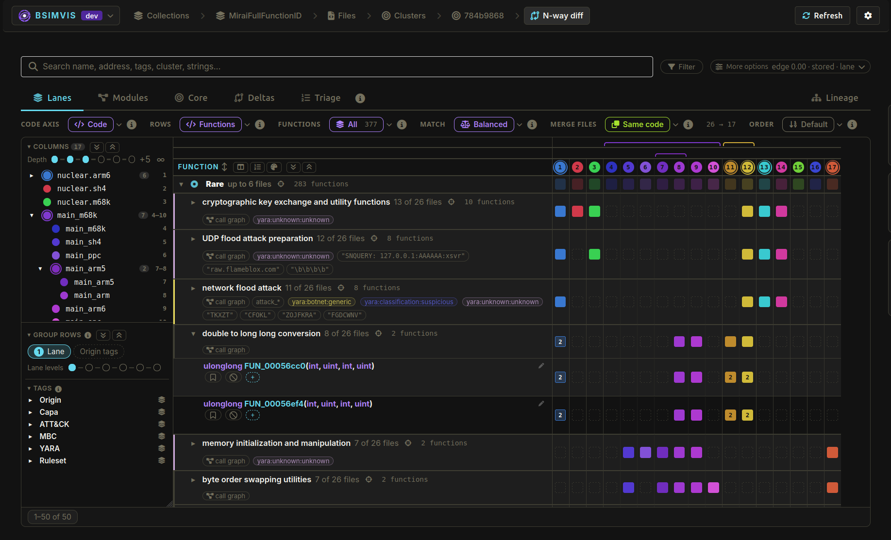

## Lineage: timeline and births

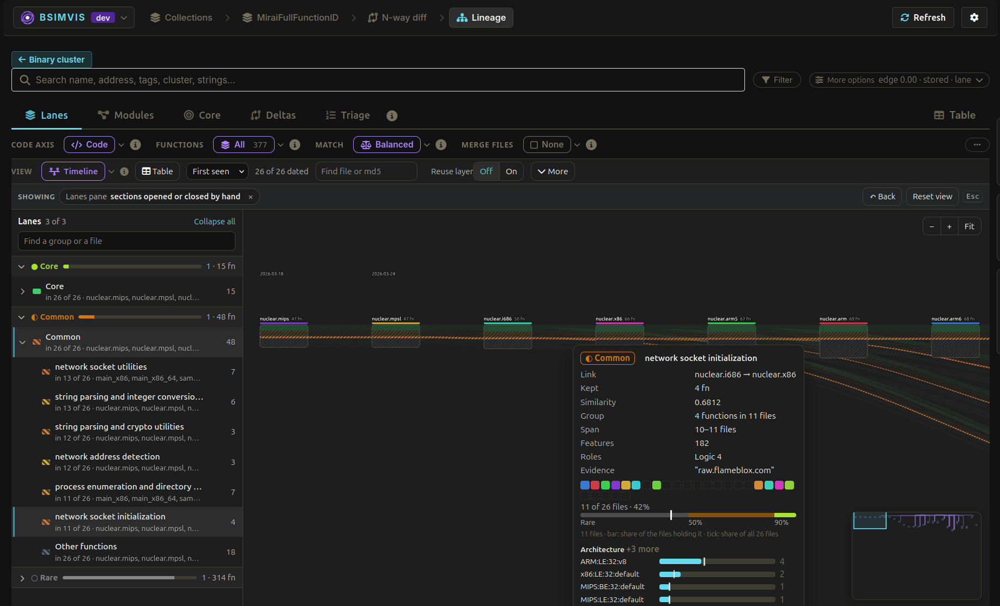

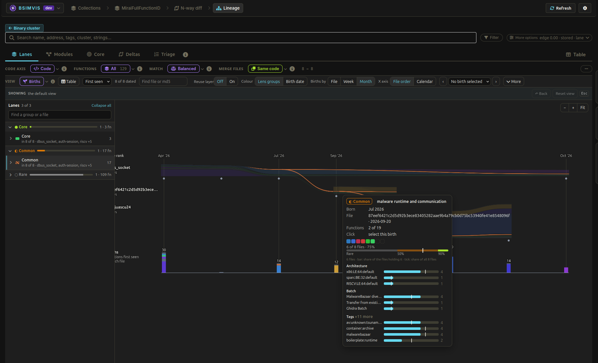

## Function CFG

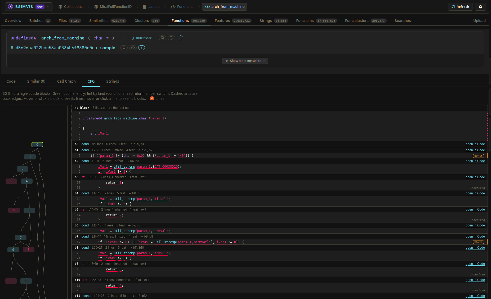

## Web UI Similarity Search Graph view

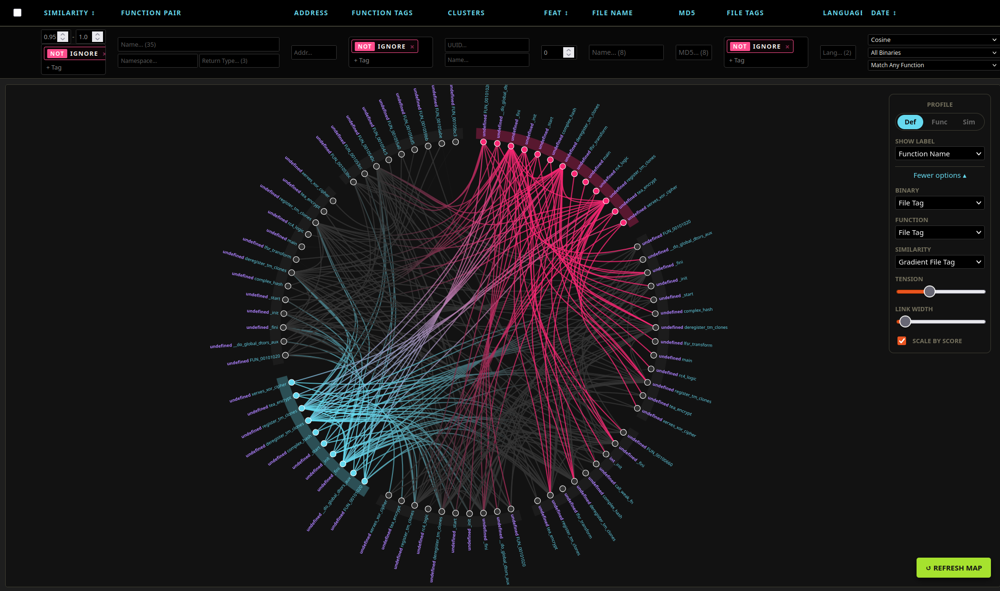

## Web UI Diffing

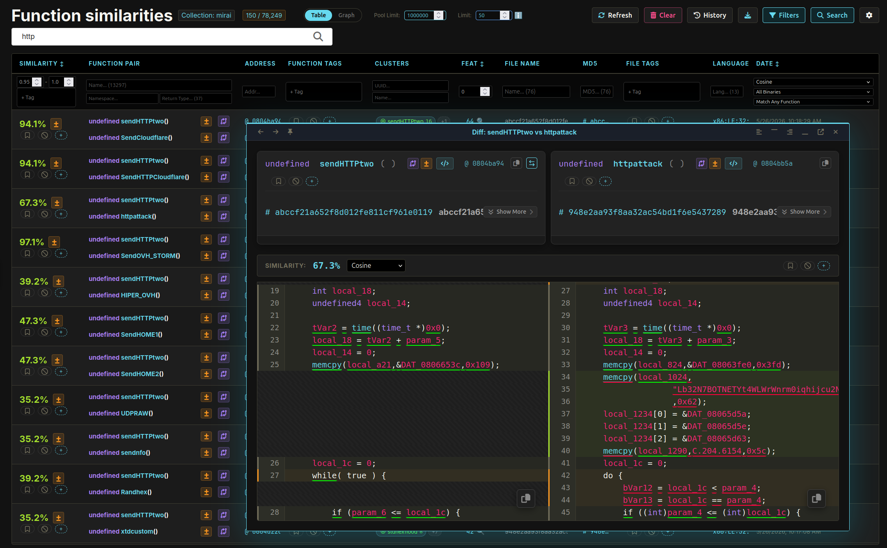

## Web UI Cluster Dendrogram 

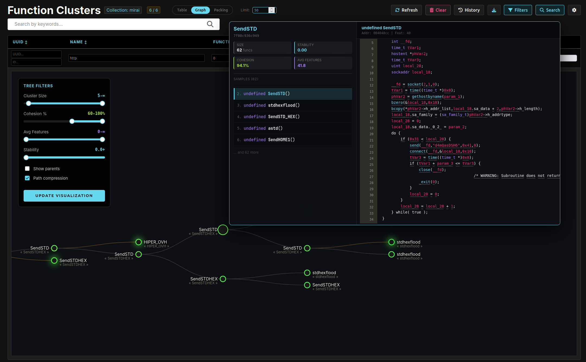

## Call graph

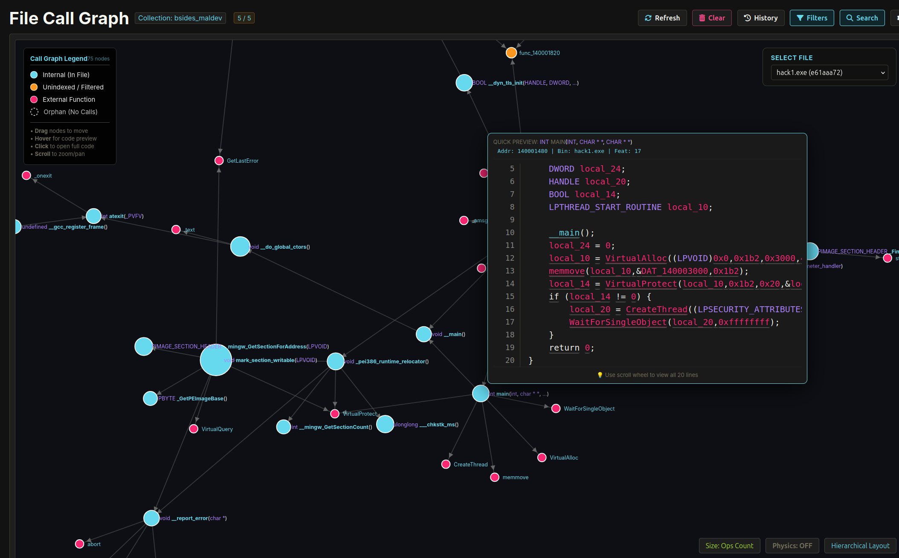

# Requirements

- Java 21+ (Ghidra 12 requirement) — `install.sh` drops a portable Temurin JDK 21 into `bin/` and sets `JAVA_HOME` in `.env` if the system Java is missing or older
- Ghidra and pyghidra install
- Redis and Kvrocks databases
- Function ID databases in the Ghidra install (see below) — without them, function library tags stay empty
- Ollama (optional) for LLM analyst insights and function summaries. Can be run locally (default port `11434`) or remotely (configurable via `ollama_url` in `bsimvis_config.toml`).
# Installation

Run the install script to set up portable Redis, Kvrocks, and optionally Ghidra:

```bash
./install.sh
```

On its first run it creates `.env` and `bsimvis_config.toml` from their `.example` files. The defaults
work as they are; edit those two files to change ports, worker count or analysis settings.

Milvus support is optional and can be enabled via the `.env` file (`ENABLE_MILVUS=true`).

## YARA rulesets

The `yara` analysis module runs against `data/yara_rules/`. No third-party rule is kept in git — only the two
in-house rules under `house/`. The other ~587 files come from
[ReversingLabs](https://github.com/reversinglabs/reversinglabs-yara-rules) (MIT),
[elastic/protections-artifacts](https://github.com/elastic/protections-artifacts) (Elastic License 2.0) and
[Neo23x0/signature-base](https://github.com/Neo23x0/signature-base) (DRL 1.1), fetched at pinned commits by
`install.sh`. Skip them with `SKIP_YARA=1 ./install.sh`, or fetch by hand later:

```bash
./scripts/fetch_yara_rules.sh
```

The Elastic rules carry the only non-OSI licence in the tree: self-hosting is fine, but it forbids offering a
substantial set of their functionality as a hosted multi-tenant service. `SKIP_ELASTIC=1 ./scripts/fetch_yara_rules.sh`
leaves them out, at the cost of roughly half the ELF/botnet detections (see `doc/yara-botnet-coverage.md`).
A thin or missing ruleset is not fatal — it means fewer tags, not failed jobs.

Pulling this change deletes the previously committed rule files from your working tree. Re-run the fetch script
afterwards, or the module scans with the two `house/` rules alone.

## Function ID databases

Ghidra's Function ID (FID) analyzer is what produces the `lib:<library>:<version>:<name>` tags BSimVis puts
on functions: standard library code identified by exact and operand-masked instruction hashes. Stock Ghidra
ships FID databases for Visual Studio runtimes only, so on ELF samples nothing gets identified until you add
databases to `$GHIDRA_HOME/Ghidra/Features/FunctionID/data/`.

`install.sh` fetches the open-source [threatrack/ghidra-fidb-repo](https://github.com/threatrack/ghidra-fidb-repo)
(MIT — 67 MB download, 215 MB unpacked, 47 databases: glibc, uClibc/OpenWrt, gcc, OpenSSL, Qt5, SDL,
libsodium, CentOS 6/7, across x86 32/64, ARM, AARCH64, MIPS, PowerPC, SPARC, SuperH, m68k). Skip it with
`SKIP_FIDB=1 ./install.sh`.

To install them by hand, into your own Ghidra:

```bash
curl -LO https://github.com/threatrack/ghidra-fidb-repo/releases/download/20200530/ghidra-fidb-repo_20200530.zip
unzip ghidra-fidb-repo_20200530.zip -d "$GHIDRA_HOME/Ghidra/Features/FunctionID/data/"
```

Those are the pre-unpacked `.fidbf` files, so no Ghidra rebuild is needed. Restart the workers afterwards —
Ghidra reads the data directory at startup.

Coverage is per-architecture and per-toolchain. No database exists for PowerPC e500, MIPS64r6, RISC-V or
LoongArch, and a statically linked binary built with a different compiler or `-O` level than the one the FIDB
was built from misses every hash even where a database exists. Build your own with Ghidra's
`Tools -> Function ID -> Populate Function ID Database` when a library matters and nothing matches it.

# Running

Use the launch script to start all services in screen sessions:

```bash
./launch.sh
```

Use `--clear` to kill stale sessions before restarting:

```bash
./launch.sh --clear
```

`launch_tmux.sh` is the tmux equivalent, and additionally caps the worker count by host
RAM and runs each worker under a memory-limited systemd scope.

On a small machine, set `DOCKER_DATASTORES=true` in `.env` before `./install.sh`: it skips
the Redis/Kvrocks source builds, and both launch scripts start them with
`docker compose up -d --wait redis kvrocks` instead (bound to `127.0.0.1`, data under
`DATA_BASE_DIR`). Milvus stays opt-in via `COMPOSE_PROFILES=milvus`. Don't run the
Docker and native Kvrocks against the same data dir at once.

### Everything in Docker

`docker compose up -d --build` builds one image (Python, Ghidra, a portable JDK, capa, UPX,
YARA rules; `install.sh` runs at build time) and starts Redis, Kvrocks, the app and
`WORKERS_COUNT` workers plus `SCAN_WORKERS_COUNT` scan workers. The dashboard is on
`127.0.0.1:${APP_PORT}`. Worker memory is capped by `WORKER_MEMORY_MAX`. The first build
downloads about 1 GB. `bsimvis_config.toml` is baked in from the example at build time:
edit it and rebuild.

### Sizing

The defaults target a 16 GB machine: 2 workers plus 1 scan worker (each a Ghidra
JVM with a 1.5 GB heap, capped at `WORKER_MEMORY_MAX=3G`), Kvrocks capped at 3 GB in
Docker, and `HOST_RESERVED_GB=6` left for Kvrocks, Redis and the desktop. Both launch
scripts lower `WORKERS_COUNT` to fit `(RAM - HOST_RESERVED_GB) / WORKER_MEMORY_MAX`.
On 8 GB, expect a single worker. With 32 GB+, raise `WORKERS_COUNT`.

On WSL2, Linux only gets half the Windows RAM by default, so a 16 GB PC sees about
8 GB, which runs 1 worker plus the scan worker. Giving WSL 12 GB (keep ~4 GB for
Windows) leaves more headroom for large samples, still with 1 worker plus the scan
worker. Set it in `%UserProfile%\.wslconfig`, then run `wsl --shutdown`:

```ini
[wsl2]
memory=12GB
```

Services are configured via `.env` (see `.env.example`). Key variables:

| Variable | Default | Description |
|---|---|---|
| `APP_HOST` | `0.0.0.0` | Bind address for the API server |
| `APP_PORT` | `5000` | API / Web UI port |
| `REDIS_HOST` | `localhost` | Redis host |
| `REDIS_PORT` | `6379` | Redis job queue port |
| `KVROCKS_HOST` | `localhost` | Kvrocks host |
| `KVROCKS_PORT` | `6666` | Kvrocks database port |
| `WORKERS_COUNT` | `2` | Number of background workers (capped by host RAM) |
| `DATA_BASE_DIR` | `./data` | Storage path for all service data |
| `DOCKER_DATASTORES` | `false` | Run Redis + Kvrocks from `docker-compose.yml` instead of built binaries |
| `KVROCKS_BLOCK_CACHE_MB` | `1024` | Kvrocks block cache in the container (Docker only) |
| `KVROCKS_MEMORY_LIMIT` | `3G` | Kvrocks container memory limit (Docker only) |
| `HOST_RESERVED_GB` | `6` | RAM kept for kvrocks, redis and the desktop when capping workers |
| `ENABLE_MILVUS` | `false` | Enable optional Milvus vector DB |
| `MILVUS_HOST` | `localhost` | Milvus host (when enabled) |
| `MILVUS_PORT` | `19530` | Milvus gRPC port |
| `MILVUS_HEALTH_PORT` | `9091` | Milvus health-check port |
| `MINIO_PORT` | `9000` | MinIO data port (Milvus storage) |
| `MINIO_CONSOLE_PORT` | `9001` | MinIO console port |
| `ETCD_PORT` | `2379` | Etcd port (Milvus metadata) |
| `GHIDRA_INSTALL_DIR` | *(auto)* | Path to Ghidra install (set by `install.sh` if needed) |
| `WORKER_MEMORY_MAX` | `3G` | Per-worker memory cap (`launch_tmux.sh` only) |

## Configuration — `bsimvis_config.toml`

Copy `bsimvis_config.toml.example` and edit to taste. Key sections:

**Analysis profiles** (`[profiles.fast]` / `[profiles.full]` / `[profiles.no-analysis]`): sets of Ghidra analyzer toggles. Pass `profile=fast` (default) or `profile=full` on upload.

**Similarity** (`[similarity]`):

| Key | Default | Description |
|---|---|---|
| `algo` | `weighted_cosine` | Similarity algorithm. A collection keeps the one of its first build |
| `top_k` | `1000` | Max neighbours per function |
| `min_score` | `0.9` | Minimum similarity score |
| `min_features` | `10` | BSim floor — functions below it are matched by exact FunctionID hash |
| `unweighted_match` | `true` | Every matched function pair counts as 1.0 in the file score (match coverage) |
| `discovery` / `discovery_min_score` | `true` / `0.4` | Re-match the functions stored edges left unmatched, down to this score, when scoring two files |

**Clustering** (`[clustering]`):

| Key | Default | Description |
|---|---|---|
| `engine` | `hierarchical_uf` | Function cluster engine: `hierarchical_uf`, `threshold_uf`, or `hdbscan` |
| `bin_engine` | `hierarchical_snn` | Binary cluster engine: `hierarchical_uf` with shared-nearest-neighbour reweighting, or one of the function engines |
| `uf_threshold` | `0.98` | Similarity edge threshold for `threshold_uf` / `hierarchical_uf` |
| `bin_uf_threshold` | `0.1` | Same, for binary clustering |
| `cohesion_cut` | `0.9` | Minimum cohesion for a cluster to be kept |
| `idle_debounce_seconds` | `30` | Quiet period after uploads before auto-cluster fires |
| `lane_stale_seconds` | `1800` | Stale lane timeout (self-heals a crashed worker) |

**Analysis modules** (`[analysis_modules]`): `enabled` lists modules that run on every upload by default (`FunctionID`, `boilerplate` and `yara`; `FunctionID` and `boilerplate` feed the code / library score split). Choices: `FunctionID`, `boilerplate`, `capa`, `yara`, `rulezet`. Override per-request with `--enable`/`--disable` (CLI) or `enable=`/`disable=` (API).

**LLM** (`[llm]`): `ollama_url`, `model`, `prompt`.

**Ghidra** (`[ghidra]`): `max_heap_mb` (per-worker JVM heap cap), `max_ram_percent` (CLI upload only), `jvm_args` (GC tuning).

**Rulezet** (`[rulezet]`): mirror of rulezet.org YARA rules. Set `url`, `api_key` (optional — enables single-call sync and tag recovery), `allow_licenses`, `baseline_dirs` (clean binaries for auto-quarantine gating), `drop` (tag glob blacklist), `[rulezet.tags]` (source-namespace → BSimVis-namespace routing). Synced with `bsimvis rulezet sync`.

**Search** (`[search]`): `max_filter_buckets` — cap on index buckets one wildcard filter may resolve to (default `200000`).

**Storage** (`[storage]`): `upload_dir` — where uploaded binaries are written before Ghidra analysis (default `data/uploads`).

# Test script

```
uv run test_api_endpoints.py
```

# Benchmark

```bash
# Ingest + similarity pipeline over the JSON fixtures in data/bench/
uv run bsimvis-bench --clear

# Benchmark the pool paths, save metrics, compare against a baseline
uv run bsimvis-bench --bench-pools --save data/bench_results/run.json
uv run bsimvis-bench --compare data/bench_results/run.json
```

# API

Full endpoint reference in [doc/api_documentation.md](doc/api_documentation.md); `curl` examples in [doc/api_examples.md](doc/api_examples.md). Interactive Swagger UI is at `/api/` when running.

## Binary upload

One call is the whole story: analysis, indexing, and per-file similarity all
run as part of this one job, and the collection's function/binary clusters
rebuild automatically a short while after uploads to it go quiet
(`clustering.idle_debounce_seconds` in `bsimvis_config.toml`, default 30s) --
see [Batch upload](#batch-upload-optional) below for why you don't need to
call anything else, even for many files at once.

```
# upload to /api/file/upload
curl -X POST --data-binary "@/path/to/file" \
  "http://localhost:5000/api/file/upload?collection=main&file_name=my_binary&profile=fast"

# Response
{
    "status": "processing",
    "file_md5": "b7680c697c69aff3cd8f44fffcb7d683",
    "pipeline_id": "b2e1a4c0-...",
    "message": "Binary uploaded. Analysis started."
}
```

Add `&priority=high` to jump this file's analysis ahead of other pending jobs
on the shared worker pool -- useful when another collection has a long-running
job tying up workers and you need one file processed fast regardless. It does
not preempt a job already running, only reorders what an idle worker picks up
next.

## Supported upload formats

`/api/file/upload` takes the raw bytes of whatever you have. Containers are unpacked server-side and every binary inside is analyzed as its own file, tagged with the format it came from and carrying the container's md5 in `parent_md5`.

| Upload | What gets analyzed | Tag |
|---|---|---|
| Raw executable (ELF, PE, Mach-O, ...) | The file itself | — |
| `.zip`, `.tar`, `.tar.gz`, `.tar.bz2`, `.tar.xz` | Every member, one file each | `container:archive` |
| Encrypted zip (ZipCrypto or AES) | Same, password defaults to `infected` | `container:archive` |
| `.apk`, `.aab` | Only `.dex`, `.so` and `.jar` members — resources and assets are skipped | `container:apk` |
| Fat/universal Mach-O | One file per architecture slice, named `<file>:x86_64`, `<file>:arm64`, ... | `container:macho-fat` |
| UPX-packed executable | **Both** the packed file and its unpacked child, so packed-vs-unpacked is a normal binary diff | `packer:upx` |
| `.gpr.zip` (Ghidra project) | Imported whole, never unpacked — see below | — |

Notes:

- Archive password: `--archive-password` on the CLI, `archive_password=` on the API. Default is `infected`, the usual convention for shipped malware samples.
- Unpacking UPX needs the `upx` binary, installed into `bin/` by `install.sh`. Without it a packed sample is still analyzed, just packed.
- Containers are followed 2 levels deep, capped at 200 children.
- `--no-unpack` (`unpack=false`) analyzes the upload exactly as-is.
- Unpacked something with your own tooling? Declare the lineage yourself with `--parent-md5` / `--parent-name` (`parent_md5=` / `parent_file_name=`).

Adding another format means one entry in `HANDLERS` in [`bsimvis/app/services/unpack_service.py`](bsimvis/app/services/unpack_service.py).

## Ghidra project upload 

Files in ghidra projects won´t get reanalyzed to not overwrite analyst work, meaning if no analyzers were ran in this project, no functions will be found

```
# Zip your .gpr and .rep project
gpr_name="my_project" # .gpr
zip -r "$gpr_name.gpr.zip" "$gpr_name.gpr" "$gpr_name.rep"

# upload to /api/file/upload
curl -X POST --data-binary @$gpr_name.gpr.zip \
  "http://localhost:5000/api/file/upload?file_name=$gpr_name&collection=main&profile=fast"
```

## Batch upload (optional)

Just upload each file with plain `POST /api/file/upload` calls, in a loop or
in parallel -- no `batch_uuid`, no finalize call needed. Every collection has
its own lane: all the files you upload analyze fully in parallel across
workers, and once uploads to that collection go quiet, the lane
automatically groups everything uploaded in that window, clears old
cluster/bin_sim results, and rebuilds function clusters, binary similarity,
and binary clusters -- once, covering the whole batch:

```
for f in /path/to/*.bin; do
  curl -s -X POST --data-binary "@$f" \
    "http://localhost:5000/api/file/upload?collection=main&file_name=$(basename $f)"
done
# each upload analyzes immediately; clustering fires on its own ~30s after the last one
```

`POST /api/cluster/rebuild_all` and `POST /api/file/upload/batch_finalize`
(explicit `pipeline_ids` list, `batch_uuid` grouping) still work for forcing
a rebuild right now instead of waiting, or for scripts that already manage
their own batching -- they queue behind whatever's currently active for that
collection instead of racing it (a collection's lane only ever runs one
clear/rebuild at a time; two overlapping requests used to corrupt each
other's results). Add `"priority": "high"` to jump an explicit request ahead
of other rebuilds already queued for that same collection. See
[doc/api_documentation.md](doc/api_documentation.md#post-apifileuploadbatch_finalize)
for `batch_finalize`'s full parameters.

## Follow pipeline progress

```
curl -s "http://localhost:5000/api/jobs/pipe_f4f87081-ab7d-4077"

# Wait for completed status 
{
...
    "id": "pipe_f4f87081-ab7d-4077",
    "progress": "100",
    "status": "completed",
...
}
```

## Build function clusters and Binary similarities

Runs automatically after uploads to a collection go quiet (see
[Batch upload](#batch-upload-optional) above). Call this directly to force it
right now instead of waiting -- it queues behind whatever's currently active
for that collection rather than running concurrently with it:

```
curl -X POST -H "Content-Type: application/json" \
 -d '{"collection": "main", "algo": "unweighted_cosine"}' \
 http://localhost:5000/api/cluster/rebuild_all

# Response -- pipeline_id is pollable via GET /api/jobs/{pipeline_id} either way,
# whether it started immediately or is waiting behind another active rebuild
{
    "job_id": "b2e1a4c0-...",
    "pipeline_id": "b2e1a4c0-...",
    "status": "queued"
}
```

# CLI tool

### Upload BSIM data

Assuming you have the API running, upload binary or ghidra project (files in ghidra projects won´t get reanalyzed to not overwrite analyst work, meaning if no analyzers were ran in this project, no functions will be found)

```bash
uv run bsimvis upload <target1> <target2> ... <targetN> -c <collection_name>
```

Key upload flags:

| Flag | Description |
|---|---|
| `--batch-split N` | Upload in independent batches of N files; each part is finalized and clustered before the next starts — results appear incrementally instead of at the end |
| `--enable MODULE` | Enable an analysis module for this run (repeatable): `FunctionID`, `capa`, `yara`, `rulezet` |
| `--disable MODULE` | Disable an analysis module for this run (repeatable) |
| `--local-analysis` | Run Ghidra analysis locally instead of on the server (requires Ghidra + pyghidra installed locally) |
| `--no-unpack` / `unpack=false` | Analyze the upload exactly as-is without unpacking archives or UPX |
| `--metadata FILE` | Enrich uploads with a metadata CSV (pipe-delimited, matched by filename) |
| `--archive-password PASSWORD` | Password for encrypted zip archives (default: `infected`) |
| `--profile fast\|full` | Ghidra analysis profile (default: `fast`) |
| `--save-json PATH` | Save analyzed JSON to disk (in addition to or instead of uploading) |

See `bsimvis_config.toml` for analysis module defaults (`[analysis_modules].enabled`).

## Job management

```bash
# List all jobs
uv run bsimvis job list

# View logs of a specific job
uv run bsimvis job status <job_id>

# Performance stats for a job/pipeline
uv run bsimvis job perf <job_id>

# Cancel a job
uv run bsimvis job cancel <job_id>
```

## Worker management

```bash
# Start workers
uv run bsimvis worker start --count 5

# Deploy analyst-only capacity scoped to one collection, pool, or pipeline
scripts/deploy_workers.sh --collection main --count 2
scripts/deploy_workers.sh --pool <pool-id> --count 2
scripts/deploy_workers.sh --pipeline <pipeline-id> --count 3

# Dedicated workers consume only matching jobs in a separate tmux session.
# Stop them with the command printed by the script.
```

## Building clusters

Clustering fires automatically after uploads to a collection go quiet (see `clustering.idle_debounce_seconds`). To trigger it manually:

```bash
uv run bsimvis cluster build -c <collection_name>
```

## Binary similarity management

```bash
# Build binary similarities
uv run bsimvis binsim build -c <collection_name>

# Get binary similarity diff between two files
uv run bsimvis binsim diff --md5-a <md5_a> --md5-b <md5_b> -c <collection_name>
```

## Collection management

```bash
# Wipe and delete a collection completely
uv run bsimvis collection delete -c <collection_name>

# Clean up temporary raw/JSON upload keys in a collection
uv run bsimvis collection clean -c <collection_name>
```

## Metadata propagation

```bash
# Propagate metadata from a pipe-delimited CSV file
uv run bsimvis metadata propagate -m <metadata_csv_path> -c <collection_name>
```

## Rulezet YARA mirror

Mirror and gate rules from [rulezet.org](https://rulezet.org) into `data/rulezet/` — a build artifact, never in git, separate
from the `data/yara_rules/` set above. Configure the `[rulezet]` section in `bsimvis_config.toml` first.

```bash
# Fetch, tag, compile and auto-quarantine the mirror
uv run bsimvis rulezet sync

# Force a full re-fetch (ignores last sync date)
uv run bsimvis rulezet sync --full

# Dry run: how many rules the next sync would add/change (writes no rules)
uv run bsimvis rulezet status          # only changes since last sync
uv run bsimvis rulezet status --full   # diff every rule against disk

# Add mirror file tags to files already in a collection. Sample bytes are not
# kept after analysis, so point it at the original files (matched by md5).
uv run bsimvis rulezet backfill -c <collection> <sample_dir> [--dry-run]

# Recover curated MISP-galaxy tags (requires api_key in config)
uv run bsimvis rulezet index-tags mitre-attack-pattern

# Show quarantined rules (false-positive gated)
uv run bsimvis rulezet quarantine

# Release a specific rule from quarantine
uv run bsimvis rulezet quarantine --release <uuid>
```

## Full CLI reference

```
usage: bsimvis [-h] [-H HOST] {features,index,sim,cluster,binsim,job,worker,upload,collection,metadata,rulezet} ...

Unified BSimVis CLI

positional arguments:
  {features,index,sim,cluster,binsim,job,worker,upload,collection,metadata,rulezet}
    features            BSim Feature management (Indexing)
    index               Index health and statistics
    sim                 Similarity management
    cluster             Unsupervised clustering management
    binsim              Binary-level similarity management
    job                 Job & Pipeline management
    worker              Worker management
    upload              Upload binaries to redis/kvrocks
    collection          Collection management
    metadata            Metadata management and propagation
    rulezet             Mirror YARA rules from rulezet.org

options:
  -h, --help            show this help message and exit
  -H, --host HOST       API host:port (default: localhost:5000, or from .env, or from bsimvis_config.toml)
```
